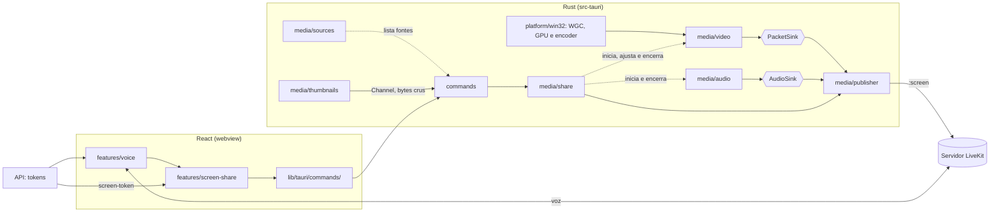
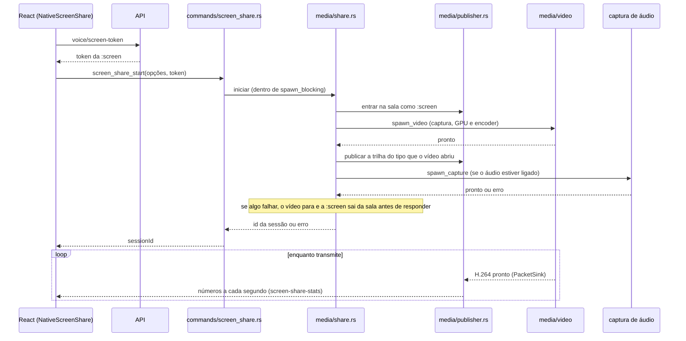

# Arquitetura

Este documento é o mapa do projeto: o que existe, onde fica e quais regras atravessam os módulos.
Ele descreve só o que muda raramente. Os motivos das decisões estão em [`docs/adr/`](docs/adr/),
e as regras de cada módulo estão no comentário `//!` no topo dele.

## Visão geral

O Ashtar é um clone do Discord para desktop, pensado para uma única comunidade de 5 a 10 pessoas: servidores,
canais de texto e canais de voz com compartilhamento de tela. O repositório tem dois projetos:

- **`desktop/`**: o app, feito com Tauri (interface em React num webview, núcleo em Rust);
- **`api/`**: o backend em Rust com Axum, que cuida de usuários, autenticação e canais, e gera os
  tokens de acesso às salas do LiveKit.

A mídia em tempo real passa por um servidor LiveKit; o projeto não implementa um servidor de mídia
próprio.

A divisão de responsabilidades segue uma regra: **cada lado cuida da mídia na direção em que é bom**
(ver [ADR 0001](docs/adr/0001-voz-no-webview-captura-no-rust.md)).

- **React (webview):** toda a interface, a conexão da voz com a sala do LiveKit, o microfone (com o
  cancelamento de eco do navegador), a reprodução das vozes e a exibição das transmissões dos outros.
- **Rust:** o que o navegador não faz bem ou não faz: capturar janelas e telas, converter e codificar o
  vídeo na GPU, capturar só o áudio de um aplicativo, falar com as APIs do sistema operacional e
  **publicar a transmissão** numa segunda conexão com a sala, `{user_id}:screen`
  ([ADR 0017](docs/adr/0017-publicador-nativo.md)). O vídeo da transmissão não passa pelo webview.

## Mapa do código

### Núcleo em Rust do app (`desktop/src-tauri/src/`)

- **`lib.rs`**: monta o app do Tauri, registra os comandos e inicializa o `tracing` e o hook de
  panic.
- **`error.rs`**: o `AppError`, único tipo de erro devolvido ao frontend, serializado como
  `{ kind, message }`.
- **`tray.rs`**: o ícone da bandeja; fechar a janela a esconde ali. **`window.rs`**: o tamanho da janela
  na primeira abertura e o `bring_to_front`.
- **`notifications.rs`**: a janela dos avisos (ADR 0022), pequena, sem borda e sempre no topo, que o
  frontend enche com os cartões; a consulta ao Windows antes de mostrar (tela cheia, apresentação); e a
  bolinha de não lido na bandeja e na barra de tarefas. A mesma janela leva o cartão da ligação que toca
  (ADR 0023): o `notification-ring` manda o cartão, e o `notification-answer` traz Atender, Recusar ou
  Responder de volta à janela principal, que vem para a frente.
- **`commands/`**: a fronteira com o frontend. Os comandos só recebem argumentos, delegam ao
  `media/` e convertem o resultado. Nenhuma lógica de captura mora aqui.
- **`media/`**: tudo que envolve a transmissão: a captura, o vídeo na GPU e a publicação.
  - **`mod.rs`**: só declarações e reexportações; o resto do código usa `crate::media::X`.
  - **`sink.rs`**: o `SinkStatus` e o `AudioSink`, que desacoplam a captura de áudio do destino.
  - **`capture.rs`**: o `spawn_capture` e o `CaptureHandle`, a forma única de criar e encerrar
    threads de captura ([ADR 0005](docs/adr/0005-threads-de-captura.md)).
  - **`sources.rs`**: os tipos das fontes (`SourceRef`, `CaptureSource`) e a lista, que o app mesmo
    monta, com as janelas minimizadas e sem as do próprio Ashtar
    ([ADR 0019](docs/adr/0019-seletor-de-fontes.md)).
  - **`audio.rs`**: o `AudioMode` e a entrada comum da captura de áudio.
  - **`video.rs`**: o formato pedido (`VideoFormat`), os comandos do meio da transmissão
    (`VideoControl`), os números (`VideoStats`) e o `spawn_video`
    ([ADR 0018](docs/adr/0018-captura-pelo-wgc-e-video-na-gpu.md)).
  - **`encoded.rs`**: o `PacketSink` e o `Fanout`, para onde vai o H.264 (ou, no plano B, o NV12), com
    mais de um destino.
  - **`bitrate.rs`**: o bitrate do encoder corrigido pelo que sai de verdade.
  - **`publisher.rs`**: a conexão `:screen` na LiveKit, com o vídeo já codificado, o áudio, os pedidos
    de keyframe e de bitrate e a pausa ([ADR 0017](docs/adr/0017-publicador-nativo.md)).
  - **`share.rs`**: o `ShareManager`, que agrupa vídeo, áudio e conexão de uma transmissão, com
    início atômico e o fim avisado uma única vez
    ([ADR 0006](docs/adr/0006-encerramento-da-sessao-por-eventos.md)).
  - **`quality.rs`**: os presets (Leve, Movimento e Nitidez) como formato de vídeo.
  - **`thumbnails.rs`**: as miniaturas ao vivo do seletor, em JPEG pelo `Channel` do Tauri.
  - **`focus.rs`**: a janela escolhida para a frente, e o Ashtar fora de toda captura.
  - **`diagnostics.rs`**: o destino que só registra no log o que recebe, para testar o áudio isolado.
  - **`platform/`**: tudo que é específico de um sistema operacional
    ([ADR 0004](docs/adr/0004-estrutura-por-plataforma.md)).
    - **`win32/`**: Windows. `wgc.rs` captura pelo Windows.Graphics.Capture, `gpu.rs` abre o
      dispositivo D3D11, `convert.rs` reduz e converte para NV12 na GPU, `mf_encoder.rs` é o
      encoder H.264 de hardware do Media Foundation, `pipeline.rs` é o laço da transmissão,
      `readback.rs` traz a imagem para a memória (plano B e miniaturas) e `thumbnails.rs` as
      miniaturas. Em `sources/`, a lista de janelas e telas e a extração de ícones. A captura de
      áudio com WASAPI fica em `audio_capture.rs`.
    - **`unsupported.rs`**: as mesmas funções para qualquer outro sistema, devolvendo listas vazias
      ou `AppError::Unsupported`.

### Frontend do app (`desktop/src/`)

- **`lib/tauri/commands/`**: a única pasta que importa `@tauri-apps/api`, com um arquivo por assunto
  (`core`, `screen-share`, `thumbnails`, `updater`, `app`, `identity`, `notifications`). Tem os tipos do contrato
  (`AppError`, `CaptureSource`, `SourceRef`) e um wrapper tipado por comando e evento.
- **`features/voice/`**: a conexão com a sala do LiveKit, em subdomínios: `room` (a conexão, mute e
  deafen), `devices` (microfone e saída), `members` (quem está na sala), `call` (a sala por dentro) e
  `dock` (o pé da coluna). O padrão das pastas de cada feature está na ADR 0014.
  O volume de cada pessoa fica em `members/stores/userVolumeStore.ts`, no `localStorage`, e chega à
  trilha por `room/model/boost.ts`, que também serve ao som da transmissão (acima de 100%, por um
  `AudioContext` com ganho).
- **`features/server/`**: a coluna e a tela do servidor, sobre a `voice`. A coluna (ADR 0020) é o
  `ServerMenu` (o nome do grupo, que é o menu de quem gerencia) e o `ChannelNav`, que mostra a lista
  de sempre (`ChannelRow`, `CategoryRow`, `ChannelMenu`, `RoomMembers`) ou, no modo Organizar, a
  `OrganizeList`, a única que monta o arrasto.
- **`features/chat/`**: o histórico de cada canal (uma consulta infinita "para trás", que nunca é
  invalidada, só recomeçada), o envio com a caixa de saída e o `client_id`, o rascunho por canal e
  quem está no grupo com a presença.
- **`features/channels/`**: a lista de canais e categorias, com a versão, e o último canal aberto.
  As mudanças de ordem ficam em `model/tree.ts`, sem React, e a cópia que o modo Organizar arruma
  antes de gravar, em `stores/organizeStore.ts`.
- **`features/members/`**: os membros no Painel e o `UserCard`, o cartão que abre ao clicar em
  alguém na lista de membros e na lista da sala. As ações do cartão são seções que quem abre passa
  como filhos.
- **`features/side-panel/`**: a lateral direita da moldura, com as abas Membros e Conversas.
- **`features/dms/`**: as conversas privadas (ADR 0021): a lista da aba Conversas, o botão Mensagem
  do cartão e as janelas abertas embaixo (`openDmsStore`, no `localStorage`). O histórico de cada
  conversa é o mesmo cache do `features/chat`: para a API, uma conversa é um canal.
- **`features/unread/`**: as não lidas, as menções e o silenciar de cada canal e conversa (ADR 0022),
  num store sem disco que o `ready` enche a cada conexão; o marcar como lido com o app em foco.
- **`features/notifications/`**: os avisos (ADR 0022). A regra fica em `model/decide.ts`; o
  `realtime.ts` decide e manda o cartão pelo Rust; o `NotificationsBridge`, na moldura, mantém o
  contexto (status, foco, o que está aberto), a bolinha e o clique. A mesma feature desenha a janela
  dos avisos, que é a segunda página do app (`notifications.html`), e a tela Configurações ›
  Notificações.
- **`features/calls/`**: as ligações privadas (ADR 0023). A máquina de estados fica em
  `model/machine.ts`, sem React (parado, chamando, tocando, conectando, em ligação e encerrada), e o
  `callStore` a guarda. O `CallBridge`, na moldura, faz a voz seguir a ligação: atender sai da sala e
  entra na da conversa, e o fim sai dela e abre a conversa. Também o botão Ligar, os avisos antes de
  ligar, a faixa da conversa, o registro no histórico (`CallEntry`), a chamada perdida e o "Voltar para
  a sala". A tela da ligação é a `VoiceRoom` de sempre, que sabe pelo `VoiceProvider` se a conexão é de
  sala ou de ligação.
- **`features/identity/`** também tem o status (Disponível, Ocupado, Invisível), com o último guardado
  no computador para abrir já com ele.
- **`lib/realtime/`**: o WebSocket da API (ADR 0015), sem React: ticket, `ping`, reconexão com espera
  crescente e o aviso de cada evento, com `resumed` no `ready` da volta de uma queda. A única pasta
  que abre `WebSocket`. Quem liga a conexão à sessão e passa cada evento ao `realtime.ts` de cada
  feature é o `app/RealtimeBridge.tsx`; com o socket fora, as consultas repetidas voltam a rodar.
- **`features/screen-share/`**: a interface `ScreenShareController` e a `NativeScreenShare`, que pede o
  token da `:screen` à API e chama os comandos do Rust; o seletor com miniaturas, os ajustes rápidos
  no botão Tela (`ShareQuickSettings`), o painel completo da transmissão (a saúde, os números, o
  envio do último minuto, quem está assistindo e desde quando) e os ajustes que os dois dividem
  (`ShareControls`).

### API (`api/`)

Backend em Rust com Axum e SQLite (`sqlx`). O desktop fala com ela por HTTP e nunca recebe as chaves do
LiveKit, só tokens já assinados. O que ainda falta entra conforme o roadmap
([`docs/roadmap.md`](docs/roadmap.md)).

A crate é uma biblioteca (`lib.rs`) com dois binários: o servidor (`main.rs`) e o `admin` temporário
(`src/bin/admin.rs`).

- **`identity/`**: as regras de membros, dispositivo, sessão, convites, permissões e o status
  (`status.rs`; o Invisível sai como offline para os outros, em toda rota e evento). Toda ação de
  administração recebe quem a faz (`actor`) e passa por `permissions::can`, o único lugar que decide quem
  pode o quê. As rotas e o `admin` chamam as mesmas funções.
- **`chat/`**: as regras do chat. `messages` (texto, envio sem duplicar pelo `client_id`, histórico
  em páginas pelo id UUID v7), `channels` e `categories` (criar, editar, arquivar, com "Gerenciar
  canais" conferido dentro, como em `identity/`) e `layout` (a árvore e a versão que dá o 409). As
  conversas privadas (ADR 0021) são canais `dm` (`dms`), e `access` é a regra de leitura: o canal de
  texto aberto, ou a conversa de que a pessoa faz parte. `read` guarda até onde cada um leu, as não
  lidas, as menções (achadas em `mentions` no envio) e o silenciar (ADR 0022). Uma mensagem tem um
  `kind`: `text` ou `call`, o registro de uma ligação.
- **`calls/`**: as ligações privadas (ADR 0023): começar, atender, recusar, desistir e desligar, o
  tempo limite de 30 s que vira chamada perdida, o fim pela saída da sala do LiveKit e o registro na
  conversa. No máximo uma ligação aberta por conversa; ao subir, a API fecha as que ficaram de antes.
- **`realtime/`**: o `Hub` do tempo real: o `broadcast` dos eventos (e o `publish_to`, só para
  algumas pessoas, que leva as mensagens privadas), os tickets de uso único e
  quem está online.
- **`voice.rs`**: o que fala com o LiveKit: quem está numa sala e tirar alguém de todas. A `:screen` de
  alguém não é participante: só marca o dono como transmitindo, e sai da sala junto com ele.
- **`routes/`**: as rotas HTTP, finas sobre as regras: a identidade (`/api/auth/*`, `/api/me`), o
  Painel (`/api/invites`, `/api/members`), a voz (`/api/voice/token`, `/screen-token` e `/participants`, só para uma
  sala aberta do banco, e o da tela só para quem já está nela), o chat (`/api/channels/...`, `/api/categories/...`, `/api/people`), as conversas privadas
  (`/api/dms`) e as ligações (`/api/dms/{id}/call`, `/accept`, `/decline`, `/cancel` e `/end`; o token
  da voz aceita o id da conversa só para os dois e só com a ligação atendida), as lidas e o silenciar (`/api/channels/{id}/read`, `/mute` e `/api/read-all`), o status
  (`/api/me/status`), o
  WebSocket (`/api/realtime/ticket` e `/api/realtime`) e o webhook do LiveKit (`/webhooks/livekit`).
  Autenticação por `Authorization: Bearer <token>`; o WebSocket, que não manda cabeçalho, entra com
  o ticket.
- **`client_policy.rs`**: a versão mínima do cliente, antes de toda rota de `/api`.
- **`limiter.rs`**: até 20 convites errados a cada 10 minutos, somando todo mundo, e 5 mensagens a
  cada 5 segundos por pessoa.
- **`db.rs`** e **`migrations/`**: o banco em modo WAL, com as migrações embutidas no binário.
- **`secret.rs`**: segredos só como SHA-256 no banco; **`error.rs`**: os erros e o formato `{ kind, message }`.

As decisões estão nas ADRs [0010](docs/adr/0010-banco-sqlite.md),
[0011](docs/adr/0011-identidade-sessao-convites.md), [0015](docs/adr/0015-chat-e-tempo-real.md) e
[0016](docs/adr/0016-canais-e-categorias.md). Os testes de integração ficam em `api/tests/`
(`identity.rs`, `chat.rs`, `channels.rs`, `dms.rs`, `read.rs`, `calls.rs` e `realtime.rs`, este com a API numa porta
de verdade).

## Fluxos

### Iniciar uma transmissão

O início é atômico: o frontend recebe uma sessão completa ou um erro, nunca uma sessão pela metade.
Durante a transmissão, o painel ajusta o preset, a fonte, o áudio, o cursor e a pausa sem republicar
a trilha (`screen_share_update`).

### Encerrar

Uma transmissão termina por quatro caminhos: o usuário para, a janela compartilhada fecha, a captura
ou o encoder falham, ou a conexão `:screen` cai. Em todos eles, quem remove a sessão do `ShareManager`
é quem emite o evento `screen-share-ended`, e ele sai exatamente uma vez; a `:screen` sai da sala na
hora, sem deixar uma transmissão fantasma. Se só o áudio cair, o vídeo continua e o evento emitido é o
`screen-share-audio-ended`.

## Invariantes e fronteiras

Regras que atravessam módulos. Quebrar uma delas costuma produzir bugs longe da causa.

- **A captura não sabe para onde os dados vão.** O vídeo sai por um `PacketSink` e o áudio por um
  `AudioSink`; nada em `platform/` conhece a LiveKit. Quem a conhece é o `publisher.rs`.
- **O vídeo da transmissão não sai da GPU até virar H.264.** Captura, redução, conversão e encoder
  dividem o mesmo dispositivo D3D11, um por transmissão
  ([ADR 0018](docs/adr/0018-captura-pelo-wgc-e-video-na-gpu.md)).
- **O Media Foundation é iniciado uma vez por processo e nunca desligado.** Um `MFShutdown` ao fim de
  cada transmissão derrubava a seguinte (`pipeline.rs`).
- **Toda thread de captura nasce por `spawn_capture`.** É ele que garante o nome da thread, a
  inicialização síncrona e o `on_end` chamado exatamente uma vez, inclusive em panic.
- **Funções que bloqueiam só rodam em `spawn_blocking`.** Estão marcadas com a seção `# Bloqueia`
  nos comentários `///`. Nunca as chame direto de um comando `async`.
- **Uma thread de captura nunca faz join em si mesma.** O `on_end` só avisa o manager; quem
  encerra é o manager, de fora da thread.
- **Só os pontos de entrada comuns chamam `platform::`.** `media/sources.rs`, `audio.rs`, `video.rs`,
  `thumbnails.rs` e `focus.rs` escolhem a implementação; o resto do código nunca usa
  `platform::win32` diretamente.
- **Só a pasta `commands/` importa `@tauri-apps/api`.** A regra de lint impede o contrário. Isso mantém
  aberta a possibilidade de uma versão web.
- **Dados binários atravessam o IPC como bytes crus** (`InvokeResponseBody::Raw`), nunca como
  `Vec<u8>` serializado em JSON. Hoje é só o das miniaturas: o vídeo da transmissão não passa pelo IPC.
- **O app nunca se lista como fonte de captura**, e a janela dele fica fora de toda captura
  (`WDA_EXCLUDEFROMCAPTURE`). Compartilhar a própria janela com áudio capturaria as vozes da chamada.
- **Todo `unsafe` tem um comentário `// SAFETY:`** explicando por que a chamada é segura.

## Plataformas

O Windows é a única plataforma suportada hoje. O código específico dele está isolado em
`media/platform/win32/`, e o projeto é pensado para receber outras sem mexer no resto:

- **Linux:** a avaliar depois. A captura passaria pelo portal do sistema com PipeWire, e o seletor de
  fontes seria o do próprio sistema no Wayland. O risco principal é o suporte a WebRTC no webview do
  Linux (WebKitGTK), que pode obrigar a voz a sair do React nessa plataforma.
- **macOS:** fora do escopo.
- **Web:** possibilidade futura, sem compromisso. A voz funcionaria sem mudanças; o compartilhamento
  seria outra implementação do `ScreenShareController`, usando o `getDisplayMedia` do navegador.

## Observabilidade

Os logs usam o `tracing`, configurado pela variável `RUST_LOG`. Em dev, o padrão é
`info,desktop=debug,desktop_lib=debug` (`desktop_lib` é onde vive quase todo o código).

- As métricas de desempenho usam o target `perf`, com campos estruturados. Para ver só elas:
  `RUST_LOG=info,perf=debug`.
- Panics em qualquer thread são registrados com o nome da thread, e toda thread criada pelo projeto
  tem nome.
- **Números de desempenho só valem em build de release.** Em dev, o código do projeto roda sem
  otimização.

## Onde está cada tipo de documentação

| Pergunta | Onde |
|---|---|
| Como rodo o projeto? | `README.md` |
| Como o projeto está organizado? | este arquivo |
| Por que decidimos assim? | `docs/adr/` |
| Quais regras este módulo protege? | `//!` no topo do módulo |
| O que esta função faz e o que não posso fazer com ela? | `///`, com as seções `# Bloqueia` e `# Panics` |
| Por que este `unsafe` é seguro? | `// SAFETY:` acima do bloco |
| O que está sendo feito agora? | `PLAN.md` e `NOTES.md` da versão atual |
| O que foi feito nas fases anteriores? | `docs/plans/` |

Documentação é atualizada no mesmo commit da mudança que a afeta.
