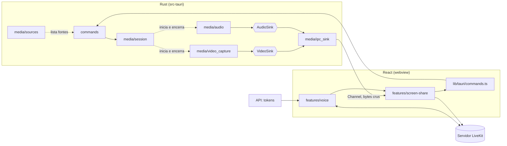
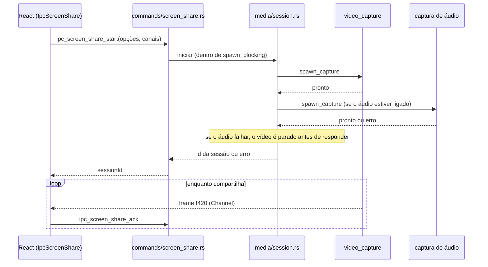

# Arquitetura

Este documento é o mapa do projeto: o que existe, onde fica e quais regras atravessam os módulos.
Ele descreve só o que muda raramente. Os motivos das decisões estão em [`docs/adr/`](docs/adr/),
e as regras de cada módulo estão no comentário `//!` no topo dele.

## Visão geral

O Ashtar é um clone do Discord para desktop, pensado para uma única comunidade de 5 a 10 pessoas: servidores,
canais de texto e canais de voz com compartilhamento de tela. O repositório tem dois projetos:

- **`desktop/`**: o app, feito com Tauri (interface em React num webview, núcleo em Rust);
- **`api/`**: o backend em Rust com Axum, que cuida de usuários, autenticação e canais, e gera os
  tokens de acesso às salas do LiveKit.

A mídia em tempo real passa por um servidor LiveKit; o projeto não implementa um servidor de mídia
próprio.

A divisão de responsabilidades segue uma regra: **cada lado cuida da mídia na direção em que é bom**
(ver [ADR 0001](docs/adr/0001-voz-no-webview-captura-no-rust.md)).

- **React (webview):** toda a interface, a conexão com a sala do LiveKit, o microfone (com o
  cancelamento de eco do navegador), a reprodução das vozes e a exibição das transmissões dos outros.
- **Rust:** o que o navegador não faz bem ou não faz: capturar janelas e telas, capturar só o áudio
  de um aplicativo e falar com as APIs do sistema operacional.

## Mapa do código

### Núcleo em Rust do app (`desktop/src-tauri/src/`)

- **`lib.rs`**: monta o app do Tauri, registra os comandos e inicializa o `tracing` e o hook de
  panic.
- **`error.rs`**: o `AppError`, único tipo de erro devolvido ao frontend, serializado como
  `{ kind, message }`.
- **`commands/`**: a fronteira com o frontend. Os comandos só recebem argumentos, delegam ao
  `media/` e convertem o resultado. Nenhuma lógica de captura mora aqui.
- **`media/`**: tudo que envolve captura.
  - **`mod.rs`**: só declarações e reexportações; o resto do código usa `crate::media::X`.
  - **`sink.rs`**: o frame capturado e os traits `VideoSink` e `AudioSink`, que desacoplam a
    captura do destino dos dados.
  - **`gate.rs`**: o `FrameGate`, contador de frames em trânsito usado para backpressure.
  - **`capture.rs`**: o `spawn_capture` e o `CaptureHandle`, a forma única de criar e encerrar
    threads de captura ([ADR 0005](docs/adr/0005-threads-de-captura.md)).
  - **`sources.rs`**: os tipos das fontes (`SourceRef`, `CaptureSource`) e a listagem, que vem do
    `DesktopCapturer` e é complementada pela plataforma
    ([ADR 0003](docs/adr/0003-listagem-de-fontes.md)).
  - **`audio.rs`**: o `AudioMode` e a entrada comum da captura de áudio.
  - **`diagnostics.rs`**: sinks que só registram no log o que recebem, para testar capturas isoladas.
  - **`video_capture.rs`**: captura de vídeo com o `DesktopCapturer`, controle de taxa e conversão
    para I420 ([ADR 0002](docs/adr/0002-captura-com-desktopcapturer.md)).
  - **`ipc_sink.rs`**: os sinks que enviam frames e áudio ao webview. Temporário
    ([ADR 0007](docs/adr/0007-envio-ao-livekit-pelo-webview.md)).
  - **`session.rs`**: o `ScreenShareManager`, que agrupa vídeo e áudio de um compartilhamento
    ([ADR 0006](docs/adr/0006-encerramento-da-sessao-por-eventos.md)).
  - **`platform/`**: tudo que é específico de um sistema operacional
    ([ADR 0004](docs/adr/0004-estrutura-por-plataforma.md)).
    - **`win32/`**: Windows. Em `sources/`, a extração de ícones, os detalhes de janelas e o
      mapeamento de monitores, com guards RAII para recursos GDI. A captura de áudio com WASAPI
      fica em `audio_capture.rs`.
    - **`unsupported.rs`**: as mesmas funções para qualquer outro sistema, devolvendo valores padrão
      ou `AppError::Unsupported`.

### Frontend do app (`desktop/src/`)

- **`lib/tauri/commands.ts`**: o único arquivo que importa `@tauri-apps/api`. Tem os tipos do
  contrato (`AppError`, `CaptureSource`, `SourceRef`) e um wrapper tipado por comando e evento.
- **`features/voice/`**: a conexão com a sala do LiveKit, mute e deafen.
- **`features/screen-share/`**: a interface `ScreenShareController` e suas implementações; hoje, a
  `IpcScreenShare`, que recebe os dados do Rust e os publica no LiveKit.

### API (`api/`)

Backend em Rust com Axum. Hoje expõe o `/health` e a geração de tokens do LiveKit; usuários,
autenticação, convites, canais, mensagens e permissões entram conforme o roadmap
([`docs/roadmap.md`](docs/roadmap.md)). O desktop fala com ela por HTTP e nunca recebe as chaves do
LiveKit, só tokens já assinados.

## Fluxos

### Iniciar um compartilhamento

O início é atômico: o frontend recebe uma sessão completa ou um erro, nunca uma sessão pela metade.

### Encerrar

Uma sessão termina por três caminhos: o usuário para, a janela compartilhada fecha, ou a captura
falha. Em todos eles, quem remove a sessão do `ScreenShareManager` é quem emite o evento
`screen-share-ended`, e ele sai exatamente uma vez. Se só o áudio cair, o vídeo continua e o evento
emitido é o `screen-share-audio-ended`.

## Invariantes e fronteiras

Regras que atravessam módulos. Quebrar uma delas costuma produzir bugs longe da causa.

- **A captura não sabe para onde os dados vão.** Capturas entregam dados a um `VideoSink` ou
  `AudioSink`; nada em `video_capture` ou `platform/` conhece IPC ou LiveKit.
- **Toda thread de captura nasce por `spawn_capture`.** É ele que garante o nome da thread, a
  inicialização síncrona e o `on_end` chamado exatamente uma vez, inclusive em panic.
- **Funções que bloqueiam só rodam em `spawn_blocking`.** Estão marcadas com a seção `# Bloqueia`
  nos comentários `///`. Nunca as chame direto de um comando `async`.
- **Uma thread de captura nunca faz join em si mesma.** O `on_end` só avisa o manager; quem
  encerra é o manager, de fora da thread.
- **Só os pontos de entrada comuns chamam `platform::`.** `media/sources.rs` e `media/audio.rs`
  escolhem a implementação; o resto do código nunca usa `platform::win32` diretamente.
- **Só o `commands.ts` importa `@tauri-apps/api`.** A regra de lint impede o contrário. Isso mantém
  aberta a possibilidade de uma versão web.
- **Dados binários atravessam o IPC como bytes crus** (`InvokeResponseBody::Raw`), nunca como
  `Vec<u8>` serializado em JSON.
- **O app nunca se lista como fonte de captura.** Compartilhar a própria janela com áudio capturaria
  as vozes da chamada.
- **Todo `unsafe` tem um comentário `// SAFETY:`** explicando por que a chamada é segura.

## Plataformas

O Windows é a única plataforma suportada hoje. O código específico dele está isolado em
`media/platform/win32/`, e o projeto é pensado para receber outras sem mexer no resto:

- **Linux:** a avaliar depois. A captura passaria pelo portal do sistema com PipeWire, e o seletor de
  fontes seria o do próprio sistema no Wayland. O risco principal é o suporte a WebRTC no webview do
  Linux (WebKitGTK), que pode obrigar a voz a sair do React nessa plataforma.
- **macOS:** fora do escopo.
- **Web:** possibilidade futura, sem compromisso. A voz funcionaria sem mudanças; o compartilhamento
  seria outra implementação do `ScreenShareController`, usando o `getDisplayMedia` do navegador.

## Observabilidade

Os logs usam o `tracing`, configurado pela variável `RUST_LOG`. Em dev, o padrão é
`info,desktop=debug,desktop_lib=debug` (`desktop_lib` é onde vive quase todo o código).

- As métricas de desempenho usam o target `perf`, com campos estruturados. Para ver só elas:
  `RUST_LOG=info,perf=debug`.
- Panics em qualquer thread são registrados com o nome da thread, e toda thread criada pelo projeto
  tem nome.
- **Números de desempenho só valem em build de release.** Em dev, o código do projeto roda sem
  otimização.

## Onde está cada tipo de documentação

| Pergunta | Onde |
|---|---|
| Como rodo o projeto? | `README.md` |
| Como o projeto está organizado? | este arquivo |
| Por que decidimos assim? | `docs/adr/` |
| Quais regras este módulo protege? | `//!` no topo do módulo |
| O que esta função faz e o que não posso fazer com ela? | `///`, com as seções `# Bloqueia` e `# Panics` |
| Por que este `unsafe` é seguro? | `// SAFETY:` acima do bloco |
| O que está sendo feito agora? | `PLAN.md` e `NOTES.md` da versão atual |
| O que foi feito nas fases anteriores? | `docs/plans/` |

Documentação é atualizada no mesmo commit da mudança que a afeta.
